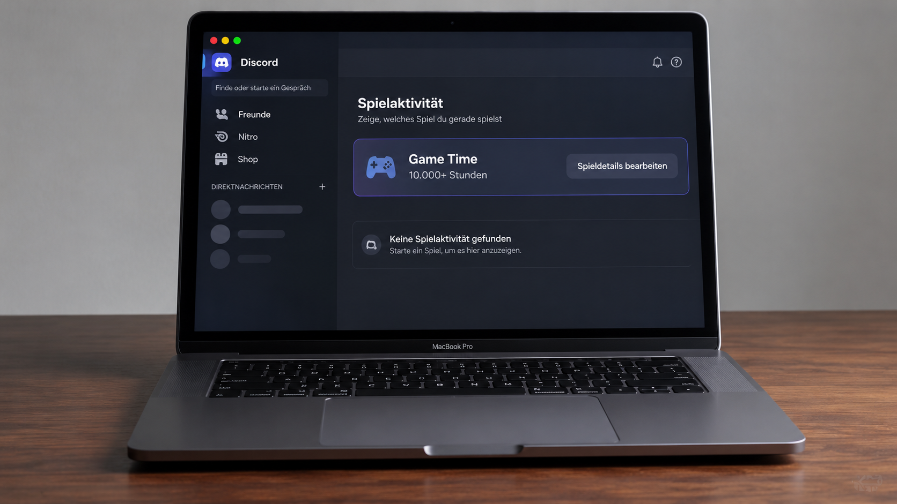
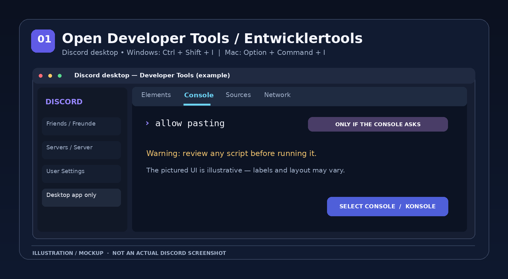
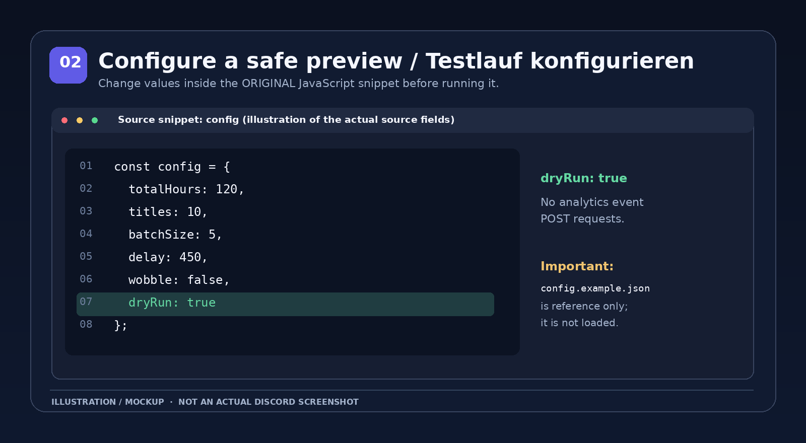
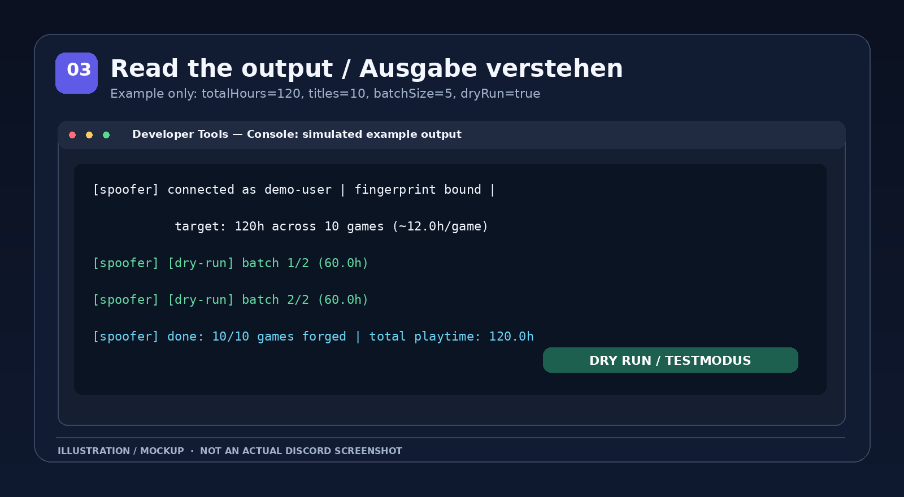
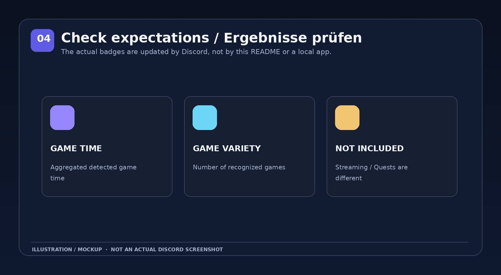

# Discord Game Time Badge Spoofer — Anleitung (Deutsch)

[**🇩🇪 Deutsch**](README_DE.md) · [**🇬🇧 English**](README_EN.md) · [**↗ Original-Gist von nvckai**](https://gist.github.com/nvckai/b258c253fa00e4300888f5cb13a905b5)



> **Bildhinweis:** Dieses Foto ist ein **generiertes Konzeptbild**, kein echter Screenshot. Die abgebildete Game-Time-Kachel ist eine Illustration und **keine** durch das Skript bereitgestellte Benutzeroberfläche.

> [!WARNING]
> **Inoffizielles Community-Skript — auf eigenes Risiko.** Das Skript manipuliert künstlich erzeugte Spielaktivitäts- und Analyseereignisse. Der Originalautor warnt selbst vor einem möglichen Verstoß gegen die Discord-Nutzungsbedingungen. Die Nutzung kann dein Konto gefährden. Weder Funktion noch Abzeichen-Fortschritt sind garantiert. **Führe keinen fremden Konsolencode aus, den du nicht geprüft hast.**

## Inhalt

1. [Was ist das?](#was-ist-das)
2. [Voraussetzungen](#voraussetzungen)
3. [Schritt-für-Schritt-Anleitung](#schritt-für-schritt-anleitung)
4. [Einstellungen erklärt](#einstellungen-erklärt)
5. [Konsolenausgabe, Stoppen und Kontrolle](#konsolenausgabe-stoppen-und-kontrolle)
6. [Häufige Fragen & Fehler](#häufige-fragen--fehler)
7. [Quellen, Sicherheit und Lizenz](#quellen-sicherheit-und-lizenz)

## Was ist das?

Der [Original-Gist von **nvckai**](https://gist.github.com/nvckai/b258c253fa00e4300888f5cb13a905b5) enthält ein JavaScript-Snippet, das im **Discord-Desktop-Client** ausgeführt werden soll. Es greift auf interne Discord-Module zu und erstellt synthetische Aktivitätsereignisse für Spielstarts und Spielzeit.

- **Game Time / Spielzeit:** Discord wertet normalerweise die Zeit in erkannten Desktop-Spielen aus.
- **Game Variety / Spielvielfalt:** Discord wertet normalerweise die Anzahl verschiedener erkannter Spiele aus.
- **Nicht Bestandteil dieses Skripts:** Streaming-Abzeichen, Discord-Quests oder ein installierbares Programm mit eigener Oberfläche.

Das Skript ist **kein offizielles Discord-Feature**, keine macOS-App, kein Discord-Bot und keine Website. Es handelt sich um einmalig in der Entwicklerkonsole gestarteten Code. Das hier angebotene Repository enthält **Dokumentation und Bilder**, aber **keine Kopie des Originalskripts**.

## Voraussetzungen

| Benötigt | Details |
|---|---|
| Discord-Desktop-App | Die Browserversion und die Mobile-App werden vom Originalskript nicht unterstützt. |
| Zugang zur Entwicklerkonsole | Laut [Discord-Hilfe](https://support.discord.com/hc/en-us/articles/115001239472-Troubleshooting-Console-Log-Errors) sind **PTB oder Canary** für den Zugriff auf die Konsole vorgesehen. In der regulären App kann sie deaktiviert sein. |
| Eigene Prüfung des Quelltexts | Den JavaScript-Code vor jeder Ausführung lesen und verstehen; keine Zugangsdaten weitergeben. |
| Verständnis der Risiken | Interne Discord-Schnittstellen können sich ändern. Übertragene Daten und Abzeichen können abgelehnt, verzögert oder zurückgesetzt werden. |

**Tastenkombinationen für die Entwicklerwerkzeuge** (bei unterstütztem Desktop-Client):

- **Mac:** `⌥ Option + ⌘ Command + I`
- **Windows:** `Ctrl + Shift + I`

Auf dem Mac ist ausdrücklich **nicht** `Ctrl + Shift + I` gemeint. Die Tastenkombination stammt aus der offiziellen Discord-Anleitung für die Konsole. Wenn sich nichts öffnet, nutze die offiziellen Informationen zu PTB/Canary; versuche nicht, Schutzmechanismen einer regulären App mit unbekannten Hilfsprogrammen zu umgehen.

## Schritt-für-Schritt-Anleitung

### Schritt 1 — Originalcode öffnen und prüfen

1. Öffne den [Original-Gist](https://gist.github.com/nvckai/b258c253fa00e4300888f5cb13a905b5).
2. Suche den Abschnitt **Snippet** unter „How to use“.
3. Prüfe den vollständigen Code, insbesondere Zugriffe auf `/users/@me`, den Spielkatalog und das interne Analyseziel `/science`.
4. Kopiere **nicht** zufällige Varianten aus Kommentaren oder fremden Webseiten. Verwende, falls überhaupt, ausschließlich den selbst geprüften Originalcode.

**Wichtig:** Die Originaldatei heißt `gametime-badge.md`, obwohl darin ausführbares JavaScript steht. Dieses Dokument enthält das Skript absichtlich nicht, weil im Gist keine ausdrückliche Weiterverbreitungslizenz ersichtlich war.

### Schritt 2 — Discord auf dem Desktop öffnen

1. Starte Discord auf deinem **Mac** oder Windows-PC und melde dich im eigenen Konto an.
2. Öffne, falls dort verfügbar, die Entwicklerwerkzeuge mit der oben genannten Tastenkombination.
3. Wähle oben den Tab **Console** (Konsole).
4. Wenn die Entwicklerkonsole eine Warnung zum Einfügen zeigt: **Nicht blind fortfahren.** Die Aufforderung `allow pasting` ist bei manchen Konsolen eine explizite Freigabe für Einfügen; gib sie nur ein, wenn du die Warnung verstehst und den einzufügenden Code geprüft hast. Nicht jede Discord-Version zeigt diese Abfrage.



*Abbildung 1: Nachgebildete Console-Ansicht. Keine Originalaufnahme; Menüs und Anordnung können abweichen.*

### Schritt 3 — Erst den Testmodus vorbereiten

Im Originalskript befindet sich direkt am Anfang ein Block `const config = { ... }`. Ändere die Werte **im JavaScript-Snippet selbst**. Zum Verständnis eignet sich folgender **Beispielblock**:

```js
const config = {
  totalHours: 120,
  titles: 10,
  batchSize: 5,
  delay: 450,
  wobble: false,
  dryRun: true
};
```

Dieses Beispiel erzeugt **nur eine Testausgabe**, weil `dryRun: true` gesetzt ist. Bei dieser Einstellung soll der Code laut seiner aktuellen Implementierung **keine Aktivitätsereignisse an `/science` senden**. Er greift allerdings weiterhin auf interne Discord-Funktionen zu und ruft Benutzer- und Katalogdaten ab.



*Abbildung 2: Der Beispielblock zeigt die tatsächlich verwendeten Optionsnamen. Die beigelegte Datei `config.example.json` dient nur als Referenz; das Originalskript liest diese Datei **nicht** automatisch.*

### Schritt 4 — Snippet in der Konsole testen

1. Prüfe noch einmal, dass `dryRun: true` im **kopierten vollständigen Originalskript** steht.
2. Füge dieses vollständige, selbst geprüfte JavaScript-Snippet in die Console ein.
3. Drücke `Enter`, um den Testlauf zu starten.
4. Lies die Konsolenausgaben. Bei einem Testlauf solltest du Zeilen mit **`[dry-run]`** sehen.

> **Nicht verwechseln:** Das hier gezeigte `const config = { ... }` ist **nicht** das gesamte Skript und kann allein keine Funktion ausführen. Eine separate `config.example.json` verändert die Ausführung ebenfalls nicht.

### Schritt 5 — Ergebnis nur als Diagnose verstehen

Ein Testlauf zeigt, wie viele Spiele der Code auswählen und welche simulierten Stunden er berechnen würde. Er bestätigt **nicht**, dass Discord Spielstunden oder Abzeichen anerkennt. Das Originalskript sendet mit `dryRun: false` dagegen künstliche Analyseereignisse an Discord. Das kann gegen die Plattformregeln verstoßen. Diese Anleitung empfiehlt keine tatsächliche Manipulation.



*Abbildung 3: Beispielwerte für `120` Stunden, `10` Spiele und `5` Spiele pro Batch. Es handelt sich nicht um die Ausgabe eines echten Kontos.*

## Einstellungen erklärt

| Einstellung | Im Original | Bedeutung |
|---|---:|---|
| `totalHours` | `6000` | Geplante **synthetische Ereignisstunden** über alle ausgewählten Spiele hinweg. **Nicht** der gewünschte Endstand des Abzeichens. |
| `titles` | `250` | Maximale Anzahl zufällig ausgewählter, im Katalog geeigneter Spiele. Tatsächlich können es weniger sein. |
| `batchSize` | `25` | Anzahl Spiele pro Übertragungs-/Testdurchlauf (Batch). |
| `delay` | `450` | Grundpause zwischen Batches in Millisekunden; der Code fügt eine kleine zufällige Abweichung hinzu. |
| `wobble` | `false` | Bei `true` werden simulierte Stunden pro Spiel leicht zufällig verändert. |
| `dryRun` | `false` | Bei `true` werden berechnete Batches nur protokolliert, **nicht** als Analyseereignisse verschickt. |

**Rechenbeispiel:** Bei `totalHours: 120` und `titles: 10` sind das ungefähr **12 Stunden je ausgewähltem Spiel**, falls mindestens zehn geeignete Einträge gefunden werden. Der Code wählt Spiele zufällig und benutzt dafür Einträge mit Windows-Executable-Metadaten (`win32`), auch wenn Discord auf einem Mac läuft. Ob Discord diese Ereignisse akzeptiert, ist nicht sichergestellt.

## Konsolenausgabe, Stoppen und Kontrolle

### Woran erkenne ich eine Testausgabe?

Mögliche Meldungen lauten (gekürztes, **fiktives** Beispiel):

```text
[spoofer] connected as demo-user | ... target: 120h across 10 games (~12.0h/game)
[spoofer] [dry-run] batch 1/2 (60.0h)
[spoofer] [dry-run] batch 2/2 (60.0h)
[spoofer] done: 10/10 games forged | total playtime: 120.0h
```

Der Begriff `forged` in der Abschlussmeldung wird vom Originalcode auch im **Testmodus** verwendet. Er ist **kein Nachweis** für eine erfolgreiche Aktualisierung der Discord-Statistik.

### Wie stoppe ich einen bereits gestarteten Lauf?

Solange das Skript in derselben Discord-Konsole aktiv ist, stellt es nach dem Start folgende Funktion bereit:

```js
window.__stopGameTimeForge()
```

Der Stopp wird an einer Batch-Grenze berücksichtigt. Er kann **bereits verschickte** Analyseereignisse **nicht zurücknehmen**. Ein Neustart des Clients macht übertragene Daten ebenfalls nicht rückgängig.

### Wie prüfe ich offizielle Badge-Informationen?

Discord beschreibt **Game Time** und **Game Variety** in seiner [offiziellen deutschsprachigen Hilfe](https://support.discord.com/hc/de/articles/44369363856663-Discord-Profilabzeichen-Was-jedes-Abzeichen-bedeutet). Der Fortschritt basiert auf erkannten Desktop-Spielen und kann verzögert angezeigt werden. Discord nennt außerdem die Einstellung **„Daten verwenden, um mein Discord-Erlebnis zu personalisieren“** als Voraussetzung für die Erfassung.



*Abbildung 4: Inhaltliche Einordnung, keine echte Profil- oder Abzeichenansicht.*

## Häufige Fragen & Fehler

**Kann ich das im Browser ausführen?**  
Nein. Das Original prüft auf interne Module des Discord-Desktop-Clients und bricht im Browser ab.

**Auf meinem Mac öffnet sich keine Konsole. Was nun?**  
Verwende die Tastenkombination `⌥ + ⌘ + I` und prüfe die [Discord-Hilfe zu PTB/Canary](https://support.discord.com/hc/en-us/articles/115001239472-Troubleshooting-Console-Log-Errors). In der Stable-Version steht die Entwicklerkonsole möglicherweise nicht zur Verfügung. Eine Funktionsgarantie auf macOS gibt es nicht.

**Ich sehe „failed to resolve rest module“ oder „failed to fetch analytics token“.**  
Der Code konnte eine interne Discord-Funktion oder notwendige Daten nicht finden. Solche undokumentierten Schnittstellen können sich ändern. **Keine Zugangstokens veröffentlichen**, keine Drittanbieter-„Fixes“ blind ausführen.

**Wozu dient `allow pasting`?**  
Das ist eine Schutzabfrage mancher Entwicklerkonsolen gegen das unüberlegte Einfügen von Code. Nur nach eigener Überprüfung fortfahren; es ist keine allgemeine Installationsanweisung.

**Mein Badge ändert sich nicht — ist das ein Fehler?**  
Nicht unbedingt. Testläufe senden keine synthetischen Ereignisse. Selbst bei einer Übertragung kann Discord Daten ablehnen oder verzögert verarbeiten. Es gibt keine garantierte Aktualisierungszeit und keinen Supportanspruch gegenüber Discord.

**Setzt `totalHours: 6000` meine gesamte Spielzeit exakt auf 6.000 Stunden?**  
Nein. Die Zahl steuert die Summe der **erzeugten Ereignisdauern**. Sie überschreibt keinen offiziellen Zähler. Mehrfaches Ausführen kann Ereignisse mehrfach erzeugen; die Verarbeitung liegt allein bei Discord.

**Hilft das bei Stream-Stunden oder Quests?**  
Nein. Das Originalskript erzeugt ausschließlich Spielstart- und Spielzeit-Ereignisse. Streaming und Discord-Quests folgen anderen Mechanismen.

**Ist `dryRun: true` vollkommen ungefährlich?**  
Nein. Der Code interagiert weiterhin mit dem eigenen Discord-Client und liest Informationen ab. Allerdings wird laut dem geprüften Quelltext im Testmodus kein künstlicher Event-Batch an den Analyse-Endpunkt gesendet. Sicherheitsprüfung bleibt notwendig.

## Quellen, Sicherheit und Lizenz

- **Autor des Originalskripts:** [nvckai — `gametime-badge.md`](https://gist.github.com/nvckai/b258c253fa00e4300888f5cb13a905b5)
- **Konsole auf Mac und Windows:** [Discord Support — Troubleshooting Console Log Errors](https://support.discord.com/hc/en-us/articles/115001239472-Troubleshooting-Console-Log-Errors)
- **Offizielle Beschreibung der Abzeichen:** [Discord Support — Profilabzeichen](https://support.discord.com/hc/de/articles/44369363856663-Discord-Profilabzeichen-Was-jedes-Abzeichen-bedeutet)
- **Quellcode:** Im Gist öffentlich einsehbar, hier **nicht enthalten**, weil keine explizite Lizenz zur Weiterverbreitung erkennbar war. Siehe [`LICENSE-NOTICE.md`](LICENSE-NOTICE.md) und [`SOURCE.md`](SOURCE.md).
- **Bilder:** Eigenständig erstellte Illustrationen. Die MacBook-Fotos sind KI-generierte Konzeptbilder. Die Schrittbilder sind schematische, speziell für diese Dokumentation erstellte Darstellungen, **keine verifizierten Screenshots einer Discord-Version**.

Dieses Repository steht in keiner Verbindung zu Discord oder dem Originalautor und wird nicht von ihnen unterstützt.
