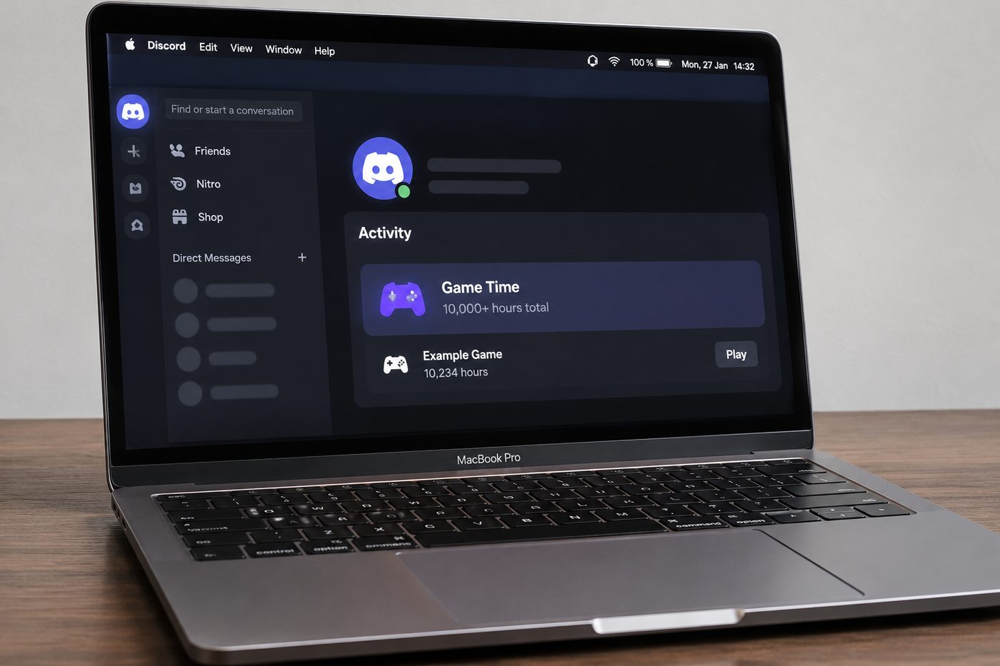
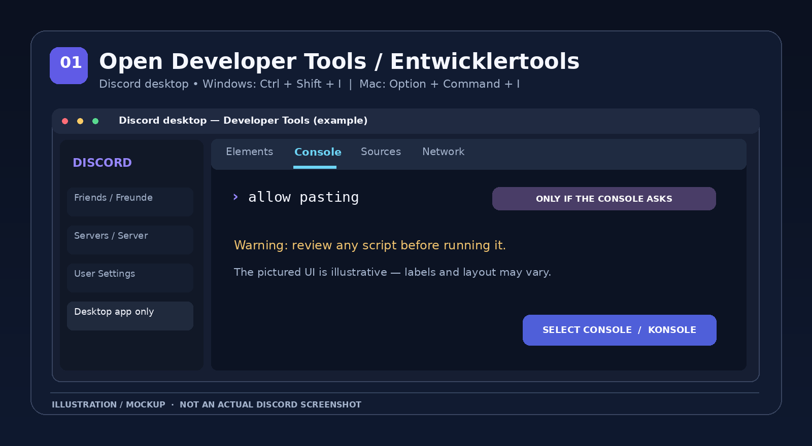
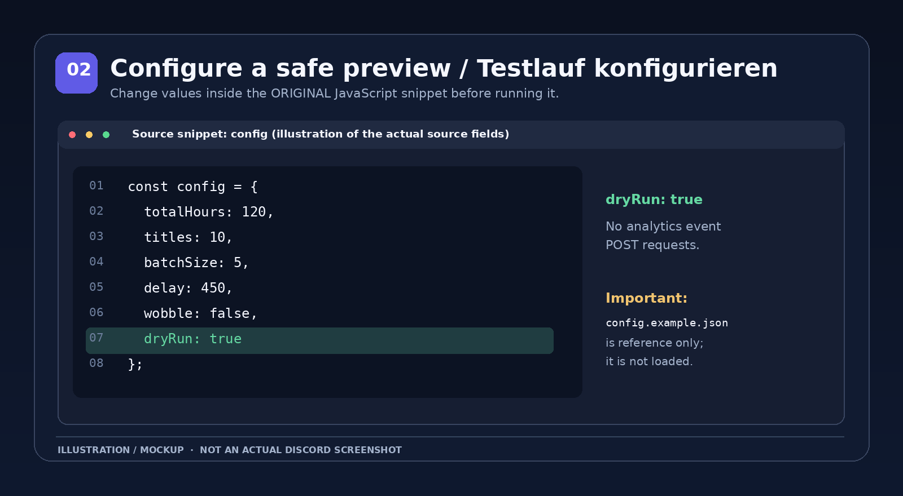
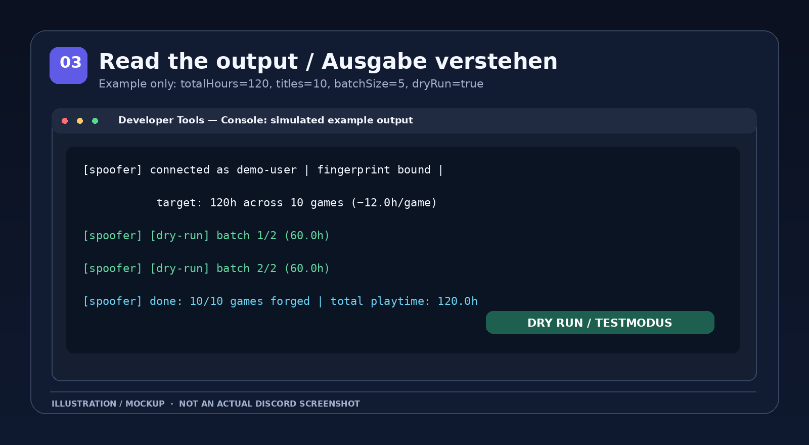
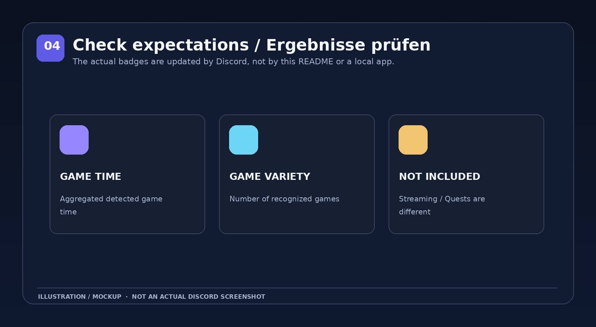

# Discord Game Time Badge Spoofer — English Guide

[**⬅ Overview**](README.md) · [**🇩🇪 Deutsch**](README_DE.md) · [**🇬🇧 English**](README_EN.md) · [**↗ Original Gist by nvckai**](https://gist.github.com/nvckai/b258c253fa00e4300888f5cb13a905b5)



> **About the image:** This is a **generated concept photo**, not a real screenshot. The Game Time tile is illustrative and **not a user interface supplied by the script**.

> [!WARNING]
> **Unofficial community script — use at your own risk.** The original script fabricates game activity and analytics events. The author warns that this may violate Discord's Terms of Service and put your account at risk. Neither successful execution nor badge progress is guaranteed. **Never execute console code you haven't personally reviewed.**

## Contents

1. [What is this?](#what-is-this)
2. [Requirements](#requirements)
3. [Step-by-step guide](#step-by-step-guide)
4. [Configuration reference](#configuration-reference)
5. [Console output, stopping and checking](#console-output-stopping-and-checking)
6. [FAQ and troubleshooting](#faq-and-troubleshooting)
7. [Sources, safety and licensing](#sources-safety-and-licensing)

## What is this?

The [original Gist by **nvckai**](https://gist.github.com/nvckai/b258c253fa00e4300888f5cb13a905b5) contains a JavaScript snippet intended to run in the **Discord desktop client**. It accesses internal Discord modules and creates artificial game-launch and game-playtime telemetry events.

- **Game Time:** Discord normally measures total playtime across games detected by its desktop app.
- **Game Variety:** Discord normally measures the number of distinct games it recognizes.
- **Not included:** Streaming badges, Discord Quests, or an installable app with its own interface.

This is **not an official Discord feature**, a macOS app, a Discord bot, or a website. It is code launched from the client’s developer console. This repository provides **documentation and illustrations**, **not a redistributed copy of the original script**.

## Requirements

| Requirement | Details |
|---|---|
| Discord desktop client | The original script does not support the browser or mobile apps. |
| Access to Developer Tools | The [official Discord instructions](https://support.discord.com/hc/en-us/articles/115001239472-Troubleshooting-Console-Log-Errors) refer to **PTB or Canary** for accessing the console. It may be disabled in the stable client. |
| Personal source review | Read the JavaScript before running it. Never share account credentials or tokens. |
| Risk awareness | Discord's undocumented internals can change. Events and badge progress can be ignored, delayed, or reversed. |

**Developer Tools shortcuts** (when supported by the desktop build):

- **macOS:** `⌥ Option + ⌘ Command + I`
- **Windows:** `Ctrl + Shift + I`

On macOS, **do not use** the Windows shortcut. Discord documents these platform-specific shortcuts. If your stable client does not open Developer Tools, consult the official PTB/Canary information instead of installing unknown workarounds.

## Step-by-step guide

### Step 1 — Open and review the original source

1. Visit the [original Gist](https://gist.github.com/nvckai/b258c253fa00e4300888f5cb13a905b5).
2. Find the **Snippet** section under “How to use”.
3. Examine the complete code, especially its access to `/users/@me`, the game catalog and the internal `/science` analytics endpoint.
4. Avoid unreviewed versions copied from comments or third-party pages. If you proceed at all, use the original code only after checking it yourself.

**Note:** The original file is called `gametime-badge.md` even though it contains executable JavaScript. This repository intentionally does not reproduce that code: no explicit redistribution license was visible on the Gist.

### Step 2 — Open Discord desktop and its console

1. Launch Discord on your **Mac** or Windows PC and sign in to your own account.
2. If supported, open the Developer Tools using the appropriate shortcut above.
3. Select the **Console** tab.
4. Some consoles display a paste protection warning. **Do not ignore it.** The phrase `allow pasting` explicitly unlocks pasting in some consoles, and should only be entered if you understand the warning and have reviewed the script. It does not appear in every Discord build.



*Figure 1: Schematic console layout, not a real screenshot. Labels and placement may differ.*

### Step 3 — Prepare a dry run first

Near the beginning of the original script, locate `const config = { ... }`. Values must be changed **inside the JavaScript snippet**. Here is an **illustrative example configuration**:

```js
const config = {
  totalHours: 120,
  titles: 10,
  batchSize: 5,
  delay: 450,
  wobble: false,
  dryRun: true
};
```

With `dryRun: true`, the current source code only **logs planned batches**, rather than posting fabricated events to `/science`. The code **still** accesses internal Discord modules and retrieves account/catalog information.



*Figure 2: The option names match the original source. The included `config.example.json` is for reference only; the original code **does not automatically load it**.*

### Step 4 — Test the snippet in the console

1. Confirm that you set `dryRun: true` **inside the complete original script** you reviewed and copied.
2. Paste that complete JavaScript snippet into the Console tab.
3. Press `Enter` to start the dry run.
4. Inspect the logged lines. A test run should include **`[dry-run]`** entries.

> **Important:** The small `const config = { ... }` example shown above is **not a standalone program**. It will not run the original operation by itself. The separate `config.example.json` file also has no effect unless you manually copy the values into the actual script.

### Step 5 — Interpret the results cautiously

A dry run demonstrates how many games are selected and how much synthetic time the code would calculate. It does **not** establish that Discord has credited playtime or badges. Changing to `dryRun: false` makes the original script send fabricated analytics events to Discord, potentially violating the platform's rules. This guide does not recommend doing so.



*Figure 3: Example values for `120` hours, `10` games and `5` games per batch. This is not a log from a real account.*

## Configuration reference

| Setting | Original default | Meaning |
|---|---:|---|
| `totalHours` | `6000` | Aggregate **synthetic event duration** across selected games; **not** an official badge total to set. |
| `titles` | `250` | Maximum number of randomly selected eligible game entries. Fewer may be available. |
| `batchSize` | `25` | Number of games per request/test batch. |
| `delay` | `450` | Base delay between batches in milliseconds; the script also introduces some random jitter. |
| `wobble` | `false` | When `true`, varies synthetic hours slightly per game. |
| `dryRun` | `false` | When `true`, only logs calculated batches and does **not** post synthetic analytics events. |

**Example:** With `totalHours: 120` and `titles: 10`, the script plans roughly **12 hours per selected game**, provided at least ten suitable game entries exist. It chooses games randomly using catalog entries that include Windows (`win32`) executable information, even when running the client on macOS. Discord accepting any events is **not** guaranteed.

## Console output, stopping and checking

### What does a dry-run log look like?

Possible output (shortened **fictional** example):

```text
[spoofer] connected as demo-user | ... target: 120h across 10 games (~12.0h/game)
[spoofer] [dry-run] batch 1/2 (60.0h)
[spoofer] [dry-run] batch 2/2 (60.0h)
[spoofer] done: 10/10 games forged | total playtime: 120.0h
```

The word `forged` in the final line appears in the original code **even during a dry run**. It does **not** prove that Discord changed any statistics.

### How do I stop a running script?

Once it starts, the original script exposes this function in the **same active console session**:

```js
window.__stopGameTimeForge()
```

The stop flag is checked between batches. It **cannot undo** analytics events that have already been sent. Restarting Discord does not roll back transmitted events either.

### Where can I check official badge rules?

Discord documents **Game Time** and **Game Variety** in its [official profile badge guide](https://support.discord.com/hc/en-us/articles/44369363856663-Discord-Profile-Badges-What-Each-Badge-Means). These badges use desktop-detected game activity, and progress may take time to appear. Discord also requires the setting **“Use data to personalize my Discord experience”** for counting progress.



*Figure 4: Conceptual comparison, not a real profile or badge screenshot.*

## FAQ and troubleshooting

**Does this work in a web browser?**  
No. The original checks for internal modules only available in Discord's desktop client.

**My Mac doesn't open the console. What should I do?**  
Use `⌥ + ⌘ + I` and review the [official Discord PTB/Canary instructions](https://support.discord.com/hc/en-us/articles/115001239472-Troubleshooting-Console-Log-Errors). Developer Tools may not be available in stable. The original script is not guaranteed to work on macOS.

**I see “failed to resolve rest module” or “failed to fetch analytics token”.**  
The script could not locate an internal Discord function or required data. Discord can change undocumented APIs at any time. **Never publish account tokens** or blindly run third-party fixes.

**Why does the Gist mention `allow pasting`?**  
Some developer consoles use it as an anti-self-XSS safeguard. Proceed only after understanding the warning and reviewing the exact code; it is not a general installation step.

**My badge hasn't changed. Is something wrong?**  
Not necessarily. Dry runs send no synthetic events. Even otherwise, Discord may reject or delay processing. There is no guaranteed wait time or official support for this script.

**Will `totalHours: 6000` set my account total to exactly 6,000 hours?**  
No. It determines the total durations of **generated events**; it does not overwrite an official counter. Running the code repeatedly can create repeated events, and only Discord determines how to process them.

**Can I use this for streamed hours or Quests?**  
No. The original only creates game-launch and playtime events. Streaming and Quests are tracked differently.

**Is `dryRun: true` completely risk-free?**  
No. The code still interacts with your logged-in Discord client and retrieves information. But according to the reviewed source, dry-run batches are not posted to the analytics endpoint. Review all code regardless.

## Sources, safety and licensing

- **Original author:** [nvckai — `gametime-badge.md`](https://gist.github.com/nvckai/b258c253fa00e4300888f5cb13a905b5)
- **Developer Tools on macOS and Windows:** [Discord Support — Troubleshooting Console Log Errors](https://support.discord.com/hc/en-us/articles/115001239472-Troubleshooting-Console-Log-Errors)
- **Official badge descriptions:** [Discord Support — Discord Profile Badges](https://support.discord.com/hc/en-us/articles/44369363856663-Discord-Profile-Badges-What-Each-Badge-Means)
- **Source code:** Available at the original Gist, **not bundled** here because an explicit redistribution license was not visible. See [`LICENSE-NOTICE.md`](LICENSE-NOTICE.md) and [`SOURCE.md`](SOURCE.md).
- **Images:** Original illustrations created for this guide. The MacBook photos are AI-generated concept imagery. The step diagrams are schematic recreations, **not verified screenshots of a specific Discord build**.

This repository is independent and is not affiliated with, endorsed by, or sponsored by Discord or the original script author.
